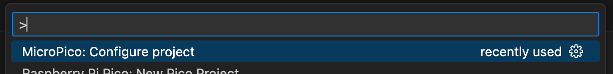

## The Skull

A glass skull crammed full of NeoPixel LEDs controlled by a Raspberry Pi Pico-W. Use the [Pimoroni setup guide](https://learn.pimoroni.com/article/assembling-wireless-plasma-kit) to get instructions on assembling the device but come back when you get to `Running the examples` as we'll be doing things slightly differently.

First thing we need to do is set up our development environment. As we're using VS Code let's use an extension called 'MicroPico'

I created a directory called `local-light` in my [Git repo](https://github.com/JimmehAH/bindicator) and opened that directory in its own VS Code window. I then used the `MicroPico: Configure project` option in the VS Code command palette.



Once it's ready it will pop up a new tab with some recommended extensions that pair well with MicroPython development. I should mention at this point that I'm using the [Black](https://github.com/psf/black) Python linter/formatter.

At this point ensure that you have a recent MicroPython environment installed. We're using a board from Pimoroni so it's easiest to use their environment as it already has hardware support built in. Download from [their release page](https://github.com/pimoroni/pimoroni-pico/releases) and use [these instructions](https://www.raspberrypi.com/documentation/microcontrollers/micropython.html#drag-and-drop-micropython) from Raspberry Pi to install it.

Create a new file called `main.py`. Copy the LED blinking demo project in to it, if you like.

You'll want to install the [type stubs from Pimoroni](https://github.com/pimoroni/pimoroni-pico-stubs/tree/main) too.

Open a Terminal in VS Code by pressing Ctrl+Shift+P or Cmd+Shift+P and in the pop-up box type `Terminal` and select `Terminal: Create New Terminal (In Active Workspace)`. Then enter these commands (substituting `~/GitRepos/)

```shell
pushd "<your preferred directory for cloning repos, e.g. ~/GitRepos>"
git clone https://github.com/pimoroni/pimoroni-pico-stubs.git pimoroni-stubs
popd # go back to your project directory
ln -s ~/GitRepos/pimoroni-stubs .vscode/pimoroni-stubs
```

Then add

The RP2040 has a built in clock but it has quite a lot of drift. Time is quite important for this project so I ordered a [dedicated RTC board](https://shop.pimoroni.com/products/rv3028-real-time-clock-rtc-breakout?variant=27926940549203). It connects via I2C[^i2c] over the QW/ST[^stemma] connector on the Plasma Stick board.

[^i2c]: [Inter-Integrated Circuit](https://en.wikipedia.org/wiki/I²C) is a serial bus for connecting peripherals to microcontrollers.

[^stemma]: Otherwise known as [STEMMA](https://learn.adafruit.com/introducing-adafruit-stemma-qt/what-is-stemma), this is a connector standard for I2C devices and allows easy prototyping.
